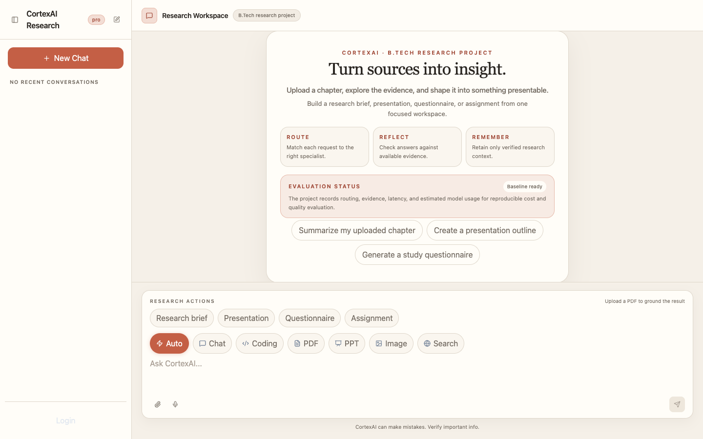
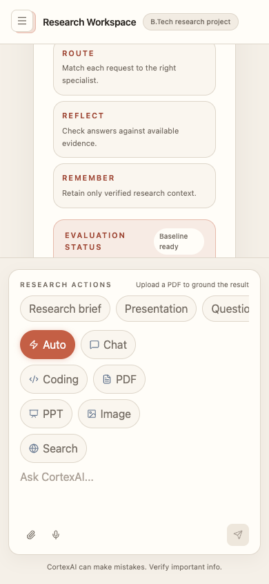

# CortexAI — B.Tech Research Project

CortexAI is a B.Tech research project investigating a closed-loop,
cost-aware, evidence-sensitive multi-agent AI system. The application is also
presented as a polished source-aware workspace: users can move from a question
or uploaded chapter to a grounded answer, structured study resource, or
finished presentation.

> **Turn sources into insight.**

## Research contribution

The project studies the **Route, Reflect, Remember (R3)** loop:

1. **Route** selects the most suitable specialist workflow and model tier.
2. **Reflect** evaluates answer claims against retrieved evidence.
3. **Remember** stores only information that passes the verification filter.

The same faithfulness signal is intentionally reused for answer gating, routing
reward, and memory writes. This creates a measurable closed loop instead of an
open-ended supervisor that only generates responses.

The system also instruments estimated token usage, model cost, latency,
specialist selection, evidence confidence, gate decisions, and memory writes.
Those fields support the cost-awareness and benchmark methodology without
claiming results that have not yet been measured.

## What users can do

- Chat naturally with an intelligent assistant.
- Upload a PDF or chapter and ask questions about its contents.
- Search the live web for current supporting information.
- Generate research briefs and topic summaries.
- Create presentation-ready slide decks.
- Generate questionnaires, answer keys, and assignments.
- Produce professional PDF documents.
- Generate and inspect code with a live artifact preview.
- Analyze images and create visual assets.
- Keep separate conversations organized in a workspace sidebar.

## A complete research workflow

```text
Question or source
        ↓
Explore and understand
        ↓
Ask focused questions
        ↓
Create a brief, quiz, assignment, PDF, or presentation
        ↓
Review and download the result
```

The interface is designed for demonstrations and real coursework: it starts
with a clear research workspace, provides guided actions, accepts source
material, and keeps generated artifacts close to the conversation that
created them.

## Research Studio experience

- Warm editorial visual language with paper surfaces, charcoal typography,
  terracotta accents, and restrained borders.
- Responsive desktop and mobile layouts.
- Guided actions for research briefs, presentations, questionnaires, and
  assignments.
- Source attachment state shown directly in the composer.
- Markdown answers with tables, links, images, and syntax-highlighted code.
- Artifact panel for generated files and previews.
- Conversation rename, delete, and workspace organization.
- Clear loading, upload, empty, and error states.

## Specialist capabilities

### Conversation

Handles explanations, brainstorming, study help, summaries, and everyday
questions while preserving the active conversation context.

### Document workspace

Uploaded PDFs are extracted, divided into meaningful passages, searched for
relevant context, and used to answer questions about the source. The document
workflow is designed to keep source-based answers focused on the uploaded
material.

### Web research

The search workflow retrieves current web information and turns the results
into a readable answer rather than returning a raw search dump.

### Coding studio

The coding assistant can generate, explain, review, debug, and improve code.
Generated files can be opened in the artifact area for inspection and preview.

### Presentation builder

The presentation workflow creates downloadable PowerPoint decks from a topic,
prompt, or source-based request.

### Document builder

The PDF workflow creates a professional downloadable document from a prompt or
research topic.

### Image and vision tools

The image workflow creates visual assets. The vision workflow analyzes
uploaded images, including visible text, charts, and tables.

## Architecture

```text
React + Vite Research Studio
              │
              ▼
       Express API Gateway
              │
    ┌─────────┼─────────┬─────────┐
    ▼         ▼         ▼         ▼
  Chat      Agent     Billing   Redis
 Service   Service    Service   Workspace memory
              │
              ▼
        LangGraph Supervisor
              │
 ┌────────────┼─────────────────────────────┐
 ▼            ▼             ▼               ▼
Chat       Coding        Search          PDF-RAG
PPT        PDF           Image           Vision
              │
              ▼
       MongoDB • Qdrant • S3
```

### Services

| Service | Port | Responsibility |
|---|---:|---|
| Gateway | 8000 | Public API entry point and service proxy |
| Chat | 8002 | Conversations and message persistence |
| Agent | 8003 | Intelligent workflows, document processing, and artifacts |
| Billing | 8004 | Optional payment flows |
| Frontend | 5173 | Vite development server |

The local demo uses an anonymous workspace identity. It is intended for a
controlled local presentation, not an unrestricted public deployment.

## Technology

| Layer | Technologies |
|---|---|
| Frontend | React, Vite, Tailwind CSS, Redux Toolkit, Framer Motion |
| Backend | Node.js, Express, microservices |
| Orchestration | LangChain and LangGraph |
| Persistence | MongoDB and Redis |
| Document retrieval | Qdrant and PDF parsing |
| AI providers | Groq, Google Gemini, OpenRouter, Tavily |
| Artifacts | PDFKit, PPTXGenJS, S3-compatible storage |

## Screenshots

### Desktop Research Studio



### Mobile Research Studio



These are fresh captures from the current frontend build. The screenshot
inventory and capture procedure are documented in
[`docs/SCREENSHOTS.md`](docs/SCREENSHOTS.md).

## Project structure

```text
frontend/                 React/Vite application
backend/gateway/          API gateway
backend/services/chat/    Conversation persistence
backend/services/agent/   Intelligent workflows and agents
backend/services/billing/ Optional payment service
backend/shared/           Shared backend utilities
docs/                     Technical handover and project documentation
screenshots/fresh/        Current interface screenshots
```

## Run locally

### Requirements

- Node.js 18 or newer
- MongoDB
- Redis
- Qdrant for document questions
- Provider credentials for the workflows you want to use
- S3-compatible storage for downloadable artifacts

### Install

```bash
cd backend
npm run build

cd ../frontend
npm install
```

### Configure

```bash
cp .env.example .env
cp frontend/.env.example frontend/.env
```

Fill the ignored local files with your own values. Important backend settings
include:

```env
FRONTEND_URL=http://localhost:5173
CHAT_SERVICE=http://localhost:8002
AGENT_SERVICE=http://localhost:8003
BILLING_SERVICE=http://localhost:8004
REDIS_URL=...
MONGODB_URL=...
GOOGLE_API_KEY=...
GROQ_API_KEY=...
OPENROUTER_API_KEY=...
TAVILY_API_KEY=...
QDRANT_URL=...
QDRANT_API_KEY=...
AWS_ACCESS_KEY_ID=...
AWS_SECRET_ACCESS_KEY=...
AWS_REGION=...
AWS_BUCKET_NAME=...
```

Frontend:

```env
VITE_SERVER_URL=http://localhost:8000
VITE_RAZORPAY_KEY=...
```

Never commit environment files, credentials, private documents, or runtime
conversation data.

### Start

Terminal 1:

```bash
cd backend
npm start
```

Terminal 2:

```bash
cd frontend
npm run dev
```

Open `http://localhost:5173`.

## Verification and benchmark status

```bash
npm --prefix backend/services/agent run test:r3
npm --prefix frontend run build
git diff --check
```

The current implementation has passing automated checks and a successful
production frontend build:

- 5 R3 unit tests pass;
- supervisor graph compilation passes;
- frontend production build passes;
- backend syntax validation passes;
- zero-cost evaluation smoke harness passes.

The benchmark harness is designed to compare:

- `always_strongest`;
- `llm_router`;
- `router_only`;
- `verifier_only`;
- `memory_only`;
- `full_r3`.

Planned metrics include routing accuracy, macro-F1, estimated cost per query,
p95 latency, evidence faithfulness, answer relevance, context relevance,
abstention rate, and memory recall. A labelled CortexBench/CortexRoute dataset
and real trace corpus are not yet included, so quantitative benchmark results
remain **TBD — run eval**. The project deliberately does not fabricate cost
savings or quality improvements.

## Deployment

The frontend can be deployed to Vercel:

```bash
vercel login
vercel --cwd frontend --prod
```

Set `VITE_SERVER_URL` in the Vercel project to the URL of a separately hosted
gateway. Vercel hosts the frontend; the Node services, MongoDB, Redis, Qdrant,
and artifact storage must be hosted separately.

Source repository:
[github.com/sakshamspr/cortex-ai](https://github.com/sakshamspr/cortex-ai)

## Documentation

- [`docs/HANDOVER_INDEX.md`](docs/HANDOVER_INDEX.md) — complete technical handover
- [`docs/HANDOVER_SYSTEM.md`](docs/HANDOVER_SYSTEM.md) — system architecture
- [`docs/HANDOVER_RUNTIME.md`](docs/HANDOVER_RUNTIME.md) — setup and operations
- [`docs/HANDOVER_FRONTEND.md`](docs/HANDOVER_FRONTEND.md) — UI and interaction details
- [`docs/HANDOVER_R3.md`](docs/HANDOVER_R3.md) — Route, Reflect, Remember implementation
- [`docs/HANDOVER_EVALUATION.md`](docs/HANDOVER_EVALUATION.md) — benchmark methodology and status
- [`docs/SCREENSHOTS.md`](docs/SCREENSHOTS.md) — screenshot provenance

## Security

Use fresh credentials for every deployment. Rotate any credentials that were
used during development, keep local environment files ignored, and do not
upload private documents or raw workspace data to the repository.
